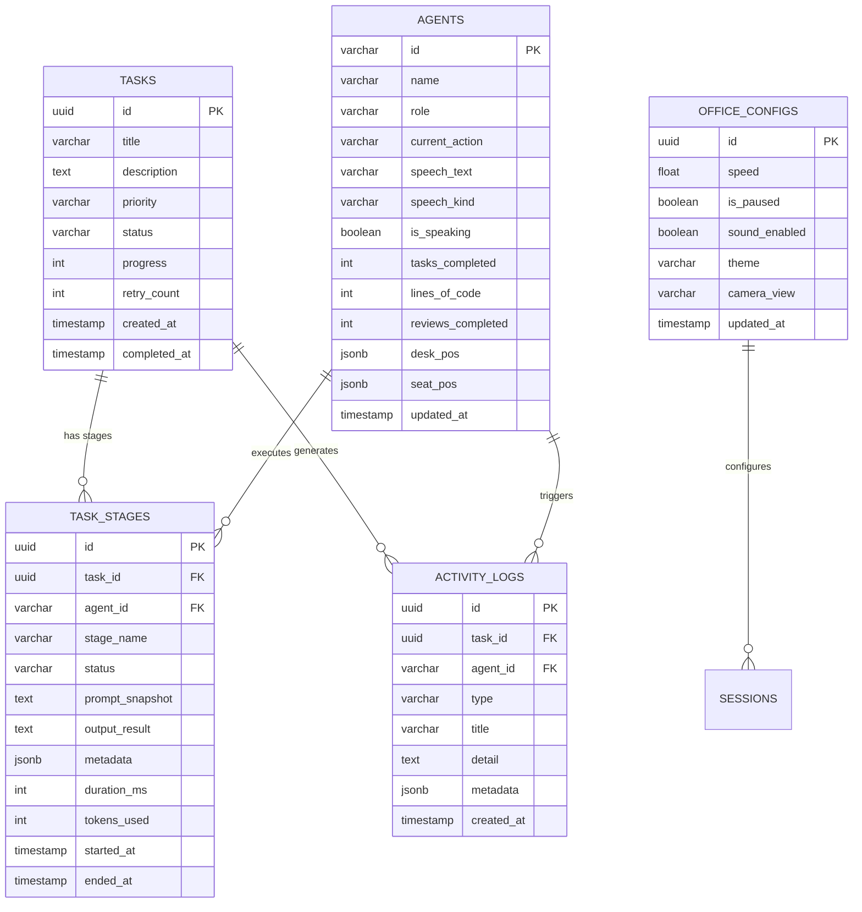
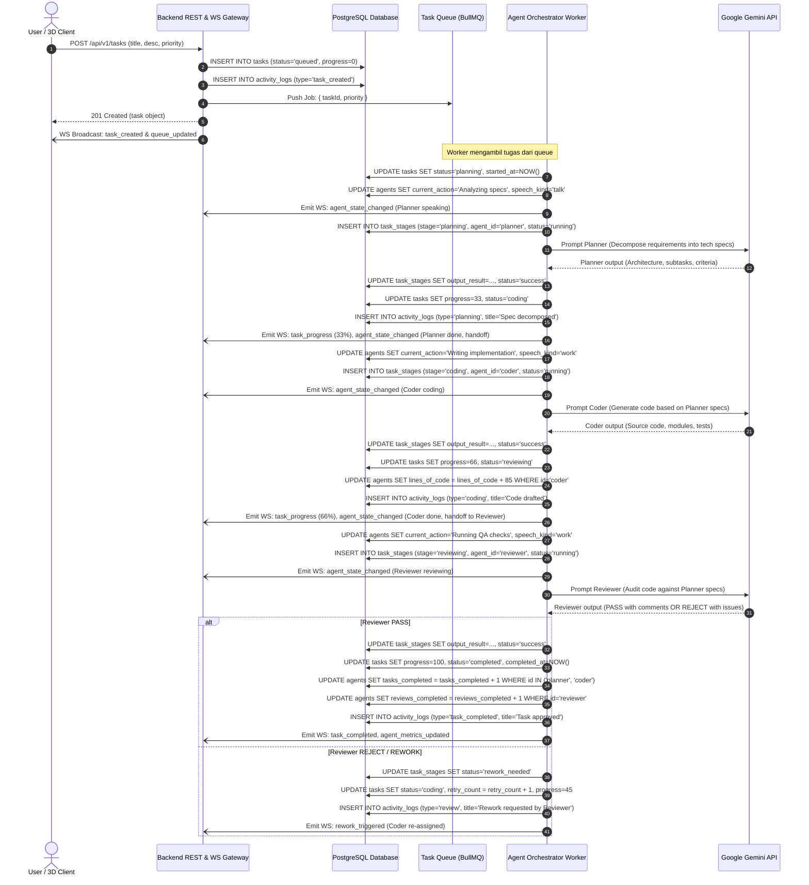
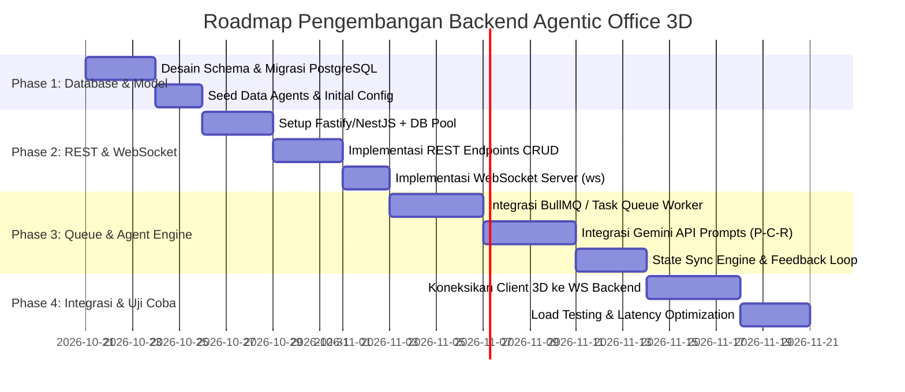

# Product Requirements Document (PRD): Backend Service
## Agentic Office 3D — Autonomous Multi-Agent Orchestration & Real-time Sync

---

## 1. Executive Summary & Objective

### 1.1 Latar Belakang
Aplikasi **Agentic Office 3D** saat ini memiliki visualisasi 3D berbasis Three.js/React yang menampilkan tiga agen otonom:
1. **Planner** (Product & Architecture Lead)
2. **Coder** (Full-Stack Engineer)
3. **Reviewer** (QA & Security Specialist)

Untuk beralih dari simulasi lokal di sisi client (mock state) menuju sistem multi-agent otonom yang sesungguhnya (*production-grade*), diperlukan backend terpusat yang:
- Mengorkestrasi pipeline eksekusi tugas (*Planner $\rightarrow$ Coder $\rightarrow$ Reviewer*).
- Berkomunikasi dengan Large Language Model (Google Gemini API).
- Menyimpan histori tugas, log aktivitas, metrik agen, dan konfigurasi kantor secara persisten ke **PostgreSQL**.
- Menyiarkan perubahan state secara *real-time* ke client 3D (posisi, animasi, speech bubble, status progress).

### 1.2 Tujuan Utama Backend
1. **Reliable Task Queue & Orchestration**: Mengelola antrean tugas secara asinkron tanpa memblokir koneksi HTTP client.
2. **PostgreSQL Relational Persistence**: Menjamin integritas data relasional untuk tasks, task execution stages, activity logs, dan agent stats.
3. **Real-time Event Streaming**: Memberikan pembaruan status agen (*idle, walk, work, talk, done*) dan speech bubble ke visualisasi 3D dengan latensi rendah (< 100ms).
4. **Resilient LLM Integration**: Memiliki retry mechanism, circuit breaker, dan fallback bila terjadi rate-limit atau timeout pada provider LLM.

---

## 2. Arsitektur Sistem Backend

### 2.1 Komponen Arsitektur
```
+-------------------------------------------------------------+
|                  Client (React + Three.js)                  |
|  - 3D Office Scene   - Control HUD   - Activity Feed Panel  |
+------------------------------+------------------------------+
                               |
                   HTTP / REST | WebSocket (Bi-directional)
                               v
+-------------------------------------------------------------+
|                     Backend API Gateway                     |
|            (Node.js / Express or Fastify / NestJS)          |
|  - Auth & Validation                                        |
|  - REST Endpoints (Tasks, Agents, Activity Logs)            |
|  - WebSocket Server (State Broadcast & Control Events)      |
+------------------------------+------------------------------+
                               |
            +------------------+------------------+
            |                                     |
            v                                     v
+-----------------------+             +-----------------------+
|  Task Queue & Worker  |             | PostgreSQL Database   |
|  (BullMQ / Pg-Boss)   |             | (Relational Store)    |
|  - Asynchronous Jobs  |             | - tasks               |
|  - Agent Pipeline     |             | - task_stages         |
+-----------+-----------+             | - agents              |
            |                         | - activity_logs       |
            v                         | - office_configs      |
+-----------------------+             +-----------------------+
| LLM Service (Gemini)  |
| - Planner Prompt      |
| - Coder Code Gen      |
| - Reviewer Evaluation |
+-----------------------+
```

### 2.2 Tech Stack Backend
- **Runtime**: Node.js (TypeScript) / Python (FastAPI opsional, direkomendasikan TypeScript agar selaras dengan model data client).
- **Web Framework**: Fastify atau NestJS (high-performance REST & native WebSocket).
- **Database**: PostgreSQL 15+ (didukung pg / Prisma ORM / Kysely / Drizzle).
- **Antrean Tugas**: Redis + BullMQ (atau PostgreSQL-backed queue via `pg-boss` / `graphile-worker` jika ingin *zero-redis dependency*).
- **Protokol Real-time**: WebSockets (`ws` / Socket.io) untuk event stream.
- **AI Engine**: Google Gemini API (`@google/genai` SDK atau Gemini REST API).

---

## 3. Database Schema Design (PostgreSQL)

Database PostgreSQL berfungsi sebagai *Single Source of Truth* untuk seluruh entitas tugas, log aktivitas, metrik agen, dan konfigurasi simulasi.

### 3.1 Entity Relationship Diagram (ERD)



### 3.2 SQL DDL (Data Definition Language)

```sql
-- Extensi untuk UUID
CREATE EXTENSION IF NOT EXISTS "uuid-ossp";

-- 1. ENUM Types
CREATE TYPE task_priority_enum AS ENUM ('low', 'medium', 'high', 'critical');
CREATE TYPE task_status_enum AS ENUM ('queued', 'planning', 'coding', 'reviewing', 'completed', 'failed', 'rejected');
CREATE TYPE agent_state_kind_enum AS ENUM ('idle', 'work', 'talk', 'walk', 'done', 'relax');
CREATE TYPE stage_status_enum AS ENUM ('pending', 'running', 'success', 'failed', 'rework_needed');
CREATE TYPE activity_type_enum AS ENUM ('task_created', 'planning', 'handoff', 'coding', 'review', 'task_completed', 'task_failed');
CREATE TYPE lighting_theme_enum AS ENUM ('daylight', 'sunset', 'cyberpunk');
CREATE TYPE camera_view_enum AS ENUM ('overview', 'planner', 'coder', 'reviewer', 'cinematic');

-- 2. Tabel AGENTS
CREATE TABLE agents (
    id VARCHAR(32) PRIMARY KEY, -- 'planner', 'coder', 'reviewer'
    name VARCHAR(100) NOT NULL,
    role VARCHAR(150) NOT NULL,
    specialty TEXT,
    bio TEXT,
    color_hex INT NOT NULL,
    color_css VARCHAR(16) NOT NULL,
    desk_pos JSONB NOT NULL DEFAULT '[-4.6, 0, -3.2]',
    seat_pos JSONB NOT NULL DEFAULT '[-4.6, 0, -2.05]',
    current_action VARCHAR(255) DEFAULT 'Idle',
    speech_text TEXT DEFAULT 'Ready for new challenges!',
    speech_kind agent_state_kind_enum DEFAULT 'idle',
    is_speaking BOOLEAN DEFAULT FALSE,
    tasks_completed INT DEFAULT 0,
    lines_of_code INT DEFAULT 0,
    reviews_completed INT DEFAULT 0,
    created_at TIMESTAMPTZ DEFAULT NOW(),
    updated_at TIMESTAMPTZ DEFAULT NOW()
);

-- 3. Tabel TASKS
CREATE TABLE tasks (
    id UUID PRIMARY KEY DEFAULT uuid_generate_v4(),
    title VARCHAR(255) NOT NULL,
    description TEXT NOT NULL,
    priority task_priority_enum NOT NULL DEFAULT 'medium',
    status task_status_enum NOT NULL DEFAULT 'queued',
    progress INT NOT NULL DEFAULT 0 CHECK (progress >= 0 AND progress <= 100),
    retry_count INT DEFAULT 0,
    max_retries INT DEFAULT 2,
    created_at TIMESTAMPTZ DEFAULT NOW(),
    started_at TIMESTAMPTZ,
    completed_at TIMESTAMPTZ,
    error_message TEXT
);

CREATE INDEX idx_tasks_status ON tasks(status);
CREATE INDEX idx_tasks_created_at ON tasks(created_at DESC);

-- 4. Tabel TASK_STAGES (Audit Trail Eksekusi Tiap Agen)
CREATE TABLE task_stages (
    id UUID PRIMARY KEY DEFAULT uuid_generate_v4(),
    task_id UUID NOT NULL REFERENCES tasks(id) ON DELETE CASCADE,
    agent_id VARCHAR(32) NOT NULL REFERENCES agents(id),
    stage_name VARCHAR(50) NOT NULL, -- 'planning', 'coding', 'reviewing'
    status stage_status_enum NOT NULL DEFAULT 'pending',
    prompt_snapshot TEXT,
    output_result TEXT,
    metadata JSONB DEFAULT '{}'::jsonb, -- token usage, reasoning, feedback
    duration_ms INT DEFAULT 0,
    tokens_used INT DEFAULT 0,
    started_at TIMESTAMPTZ,
    ended_at TIMESTAMPTZ
);

CREATE INDEX idx_task_stages_task_id ON task_stages(task_id);
CREATE INDEX idx_task_stages_agent_id ON task_stages(agent_id);

-- 5. Tabel ACTIVITY_LOGS
CREATE TABLE activity_logs (
    id UUID PRIMARY KEY DEFAULT uuid_generate_v4(),
    task_id UUID REFERENCES tasks(id) ON DELETE SET NULL,
    agent_id VARCHAR(32) REFERENCES agents(id) ON DELETE SET NULL,
    type activity_type_enum NOT NULL,
    title VARCHAR(255) NOT NULL,
    detail TEXT,
    metadata JSONB DEFAULT '{}'::jsonb,
    created_at TIMESTAMPTZ DEFAULT NOW()
);

CREATE INDEX idx_activity_logs_created_at ON activity_logs(created_at DESC);
CREATE INDEX idx_activity_logs_task_id ON activity_logs(task_id);

-- 6. Tabel OFFICE_CONFIGS
CREATE TABLE office_configs (
    id UUID PRIMARY KEY DEFAULT uuid_generate_v4(),
    workspace_name VARCHAR(100) DEFAULT 'Main Office',
    speed REAL DEFAULT 1.0,
    is_paused BOOLEAN DEFAULT FALSE,
    sound_enabled BOOLEAN DEFAULT TRUE,
    theme lighting_theme_enum DEFAULT 'daylight',
    camera_view camera_view_enum DEFAULT 'overview',
    updated_at TIMESTAMPTZ DEFAULT NOW()
);

-- Seed Initial Agents
INSERT INTO agents (id, name, role, specialty, bio, color_hex, color_css, desk_pos, seat_pos, current_action, speech_text)
VALUES
('planner', 'Planner', 'Product & Architecture Lead', 'Requirement analysis, scope decomposition', 'Breaks complex client specs into actionable engineering sprints.', 16739211, '#ff6b8b', '[-4.6, 0, -3.2]', '[-4.6, 0, -2.05]', 'Idle', 'Ready for new challenges!'),
('coder', 'Coder', 'Full-Stack Software Engineer', 'Component architecture, state management', 'Converts specifications into robust, type-safe implementations.', 5170431, '#4ee3ff', '[0, 0, -3.2]', '[0, 0, -2.05]', 'Idle', 'Ready to code!'),
('reviewer', 'Reviewer', 'QA & Security Specialist', 'Static analysis, performance profiling', 'Conducts rigorous code verification and security audits.', 5239162, '#4fef7a', '[4.6, 0, -3.2]', '[4.6, 0, -2.05]', 'Idle', 'Standing by for review.');
```

---

## 4. Backend Workflow & End-to-End Orchestration

Alur kerja backend dibagi menjadi 5 tahap utama yang berjalan berkesinambungan antara antrean, worker, LLM engine, PostgreSQL, dan visualisasi 3D.

### 4.1 Master Workflow Diagram



### 4.2 Detail Tiap Tahapan Workflow

#### Tahap 1: Ingestion & Queuing
1. Client mengirim payload task (`title`, `description`, `priority`).
2. Backend API Gateway melakukan validasi skema (Zod / Joi).
3. Data disimpan ke PostgreSQL tabel `tasks` dengan status `queued`.
4. Job dimasukkan ke dalam antrean (queue) dengan bobot prioritas:
   - `critical` $\rightarrow$ Priority 1 (dikerjakan paling awal)
   - `high` $\rightarrow$ Priority 2
   - `medium` $\rightarrow$ Priority 3
   - `low` $\rightarrow$ Priority 4
5. Backend membroadcast event `task_queued` ke seluruh koneksi WebSocket aktif.

#### Tahap 2: Orchestration Pipeline (Planner $\rightarrow$ Coder $\rightarrow$ Reviewer)
1. **Planner Agent**:
   - Menerima deskripsi kebutuhan.
   - Mengonsumsi Gemini API dengan System Instruction khusus Software Architect.
   - Menghasilkan daftar arsitektur, boundary modul, dan acceptance criteria.
   - Status task bergeser: `queued` $\rightarrow$ `planning` $\rightarrow$ progress 33%.
   - Backend memicu broadcast 3D: Planner berjalan ke meja, gestur `talk`/`work`, speech bubble muncul.

2. **Coder Agent**:
   - Menerima arsitektur dari Planner sebagai konteks input.
   - Mengonsumsi Gemini API dengan System Instruction Senior Full-Stack Engineer.
   - Menghasilkan kode implementasi, dokumentasi fungsi, dan unit test.
   - Status task bergeser: `planning` $\rightarrow$ `coding` $\rightarrow$ progress 66%.
   - Backend memicu broadcast 3D: Coder mengetik cepat di meja, suara ketikan aktif.

3. **Reviewer Agent**:
   - Menerima spesifikasi dari Planner dan hasil kode dari Coder.
   - Mengonsumsi Gemini API dengan System Instruction QA & Security Auditor.
   - Menjalankan evaluasi: format output terstruktur JSON `{ decision: "APPROVED" | "REWORK", score: 95, comments: "..." }`.

#### Tahap 3: Verification & Feedback Loop
- **Jika "APPROVED"**:
  - `tasks.status` diubah menjadi `completed`.
  - `tasks.progress` menjadi 100%.
  - `agents.tasks_completed` di-increment.
  - Broadcast event `task_completed` ke 3D visualizer (agen melakukan gestur `done` / selebrasi).
- **Jika "REWORK"**:
  - Jika `retry_count < max_retries`:
    - Mengirim feedback reviewer kembali ke agent **Coder**.
    - `tasks.status` kembali ke `coding`, `retry_count` bertambah 1.
    - Coder merevisi kode sesuai catatan Reviewer.
  - Jika `retry_count >= max_retries`:
    - `tasks.status` diubah menjadi `failed`.
    - Activity log mencatat alasan kegagalan.

#### Tahap 4: Real-time 3D Synchronization
Setiap kali ada perubahan status di database atau tahap eksekusi, Backend memancarkan payload ringkas melalui WebSocket:
```json
{
  "event": "agent_state_update",
  "data": {
    "agentId": "coder",
    "currentAction": "Writing TypeScript interfaces",
    "speechText": "Translating specs into type definitions...",
    "speechKind": "work",
    "isSpeaking": true,
    "taskId": "7f9c2d1b-...",
    "taskProgress": 48
  }
}
```

---

## 5. Spesifikasi API (REST & WebSocket)

### 5.1 REST Endpoints

| Method | Endpoint | Deskripsi | Request Body | Response Body |
|---|---|---|---|---|
| `GET` | `/api/v1/health` | Healthcheck server & DB | - | `{ "status": "ok", "db": "connected", "uptime": 1240 }` |
| `POST` | `/api/v1/tasks` | Membuat task baru | `{ "title": string, "description": string, "priority": "low"\|"medium"\|"high"\|"critical" }` | `{ "success": true, "task": TaskObject }` |
| `GET` | `/api/v1/tasks` | Mengambil list task | Query: `?status=...&limit=20&page=1` | `{ "tasks": [TaskObject], "total": 45 }` |
| `GET` | `/api/v1/tasks/:id` | Detail task beserta stage logs | - | `{ "task": TaskObject, "stages": [TaskStageObject] }` |
| `PATCH` | `/api/v1/tasks/:id/cancel` | Membatalkan task yang antre/berjalan | - | `{ "success": true, "message": "Task cancelled" }` |
| `GET` | `/api/v1/agents` | Status terkini 3 agen & metriknya | - | `{ "agents": { "planner": AgentInfo, "coder": AgentInfo, "reviewer": AgentInfo } }` |
| `GET` | `/api/v1/activities` | Mengambil log aktivitas kantor | Query: `?limit=50&agentId=coder` | `{ "activities": [ActivityLogObject] }` |
| `GET` | `/api/v1/simulation/config` | Mengambil konfigurasi kantor | - | `{ "config": OfficeSimConfig }` |
| `PUT` | `/api/v1/simulation/config` | Update speed, pause, theme, camera | `{ "speed": 1.5, "isPaused": false, "theme": "cyberpunk" }` | `{ "success": true, "config": OfficeSimConfig }` |

### 5.2 WebSocket Specification

- **Endpoint**: `ws://<host>:<port>/ws/office`
- **Protokol Pesan**: JSON formatted message dengan struktur:
  ```typescript
  interface WebSocketMessage<T = any> {
    event: string;
    timestamp: number;
    data: T;
  }
  ```

#### Events dari Server ke Client (Broadcast):
1. `agent:state_changed`: Perubahan aksi, speech bubble, atau animasi agen.
2. `task:queued`: Task baru berhasil didaftarkan.
3. `task:progress`: Pembaruan persentase progres task.
4. `task:completed`: Task selesai dieksekusi dengan sukses.
5. `activity:new`: Log baru muncul di audit feed.
6. `sim:config_changed`: Sinkronisasi status pause/play dan tema pencahayaan.

#### Events dari Client ke Server:
1. `client:subscribe`: Client menyambung ke channel workspace tertentu.
2. `sim:toggle_pause`: Client meminta pause eksekusi agent di backend.
3. `agent:interact`: Client mengklik agen di layar 3D untuk memicu respon dialog manual.

---

## 6. Kebutuhan Non-Fungsional (Non-Functional Requirements)

### 6.1 Performa & Latensi
- **Response Time API**: $< 80\text{ ms}$ untuk pembacaan state dari PostgreSQL.
- **WebSocket Broadcast Latency**: $< 50\text{ ms}$ sejak trigger di worker hingga diterima oleh client 3D.
- **Database Connection Pooling**: Menggunakan pool (`max: 20` koneksi per instance) untuk efisiensi PostgreSQL.

### 6.2 Keandalan & Error Handling
- **Idempotency**: Panggilan berulang untuk membuat task yang sama dicegah menggunakan token idempotensi atau deduplikasi hash konten task.
- **Circuit Breaker pada LLM**: Jika Gemini API mengalami `HTTP 429 Too Many Requests` atau `HTTP 503`, worker mengeksekusi *exponential backoff* (delay 2s, 4s, 8s) dan memberikan sinyal ke agen 3D untuk status `"Waiting for AI quota..."`.
- **Graceful Shutdown**: Saat server di-restart, task yang sedang berjalan di worker disimpan statusnya sebagai `checkpoint` di tabel `task_stages` agar dapat dilanjutkan tanpa kehilangan konteks.

### 6.3 Keamanan (Security)
- **Environment Isolation**: API key Gemini disimpan secara aman di backend environment variable (`.env`), tidak pernah bocor ke bundle client 3D.
- **Input Sanitization**: Seluruh deskripsi dan prompt dicegah dari potensi prompt injection ekstrem dan payload SQL berbahaya (menggunakan parameterized queries / ORM).
- **CORS & Rate Limiting**: Membatasi request per IP (`express-rate-limit` atau `fastify-rate-limit`) untuk endpoint publik.

---

## 7. Rencana Implementasi & Roadmap Pengembangan



### Milestone & Deliverables:
1. **Milestone 1 (Database Ready)**: Skema PostgreSQL terpasang, file migrasi siap, koneksi pool teruji.
2. **Milestone 2 (Core Gateway)**: API REST tasks dan WebSocket broadcast aktif, client 3D menerima event test.
3. **Milestone 3 (Autonomous Agent Engine)**: Pipeline Planner $\rightarrow$ Coder $\rightarrow$ Reviewer berjalan otomatis memproses tugas menggunakan Gemini API.
4. **Milestone 4 (Full Production)**: Penanganan error, retry policy, metrik persistensi, dan pengujian beban selesai.
